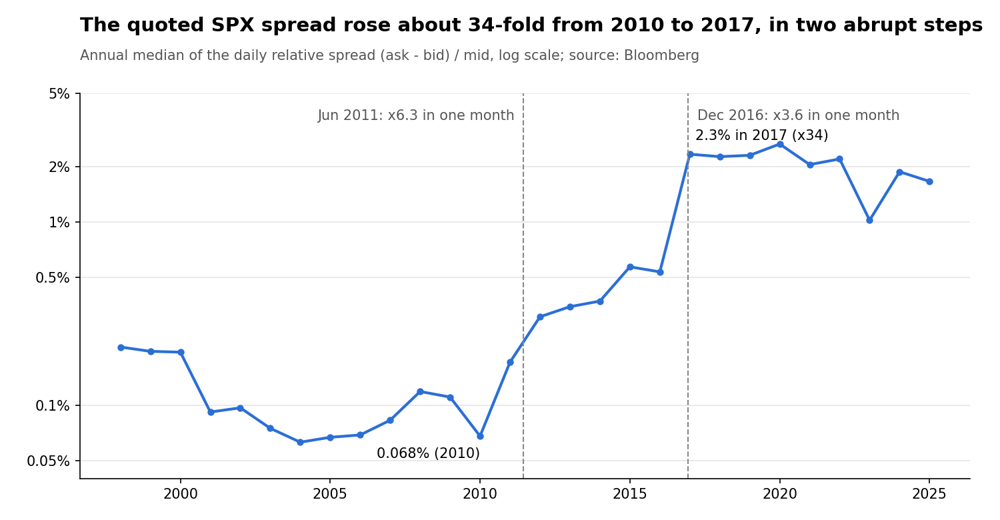

# Regime-Aware Forecasting of S&P 500 Bid-Ask Spreads

*Shangrong Li, Siyu Liang, Wenyi Ye*

[中文翻译](report_zh.md)

## Abstract

Once look-ahead bias is removed, daily S&P 500 relative bid-ask spreads are only moderately predictable: the best model, a linear regression on the log spread, reaches an out-of-sample R² of 0.36 and a mean squared error 28% below the persistence forecast (tomorrow = today). We study 6,972 Bloomberg trading days (1998–2025) with a fully out-of-sample design: a rolling Hidden Markov Model (HMM) whose regime probabilities are computed by forward filtering, and rolling-window linear, XGBoost and LightGBM forecasts compared with Diebold–Mariano tests.

Three findings stand out. First, gradient boosting does not beat the linear model, and adding HAR-style long-memory features (5/22/63-day average log spread) is the only change that significantly improves accuracy (typical-day absolute log error 0.210 → 0.193, p < 0.001). Second, the HMM identifies persistent regimes in which forecast errors are about eight times larger, but its probabilities add no predictive value for point forecasts, spike classification or interval forecasts once simpler signals are available. Third, two data issues matter more than any modelling choice: vendor-filled holiday rows, and two methodology-like level shifts in the index quote (June 2011, December 2016). Using smoothed in-sample regime probabilities and full-sample outlier filtering would inflate the out-of-sample R² to about 0.89; we show how.

## 1 Introduction

We ask whether market regimes help forecast the daily SPX bid-ask spread, and find that they describe risk well but do not improve forecasts. The bid-ask spread is the market maker's compensation for order-processing, inventory and adverse-selection costs (Glosten & Milgrom, 1985; Kyle, 1985). Spreads widen when volatility and information asymmetry rise, which suggests that a regime-aware model could forecast them better than a single-regime one.

### 1.1 Research questions

1. How predictable is the daily relative spread out of sample, relative to a persistence forecast?
2. Do non-linear learners (XGBoost, LightGBM) improve on a linear model?
3. Do regime probabilities from a rolling HMM add predictive value for point forecasts, spike forecasts or forecast intervals?
4. Which simple, economically motivated features (long-memory averages, calendar effects) improve accuracy?

### 1.2 Contributions

- **A leak-free evaluation design.** Every feature and every regime probability uses only information available before the forecast day; we show that a smoothed, in-window HMM inflates out-of-sample R² from about 0.36 to 0.89.
- **A negative result for regime features, tested from several angles:** an ablation, three redesigned HMMs, and interval and spike-forecast tasks.
- **Data diagnostics** for the Bloomberg index quote that any study using this series should account for.
- **Positive results** for log-space modelling and HAR long-memory features, and in-sample evidence of holiday and option-expiry effects.

## 2 Data

The sample has 6,972 trading days of Bloomberg data for the S&P 500 index (2 March 1998 to 13 November 2025), after removing 1 invalid quote and 256 vendor-filled holiday rows. The target is the relative spread, (PX_ASK − PX_BID) / PX_MID. Predictors come from PX_LAST, PX_VOLUME, PX_CLOSE_1D and BEST_PE_RATIO.

### 2.1 Vendor-filled holidays

Bloomberg fills exchange holidays (Christmas, New Year, Thanksgiving and others) with a verbatim copy of the previous trading day: identical close, volume and quotes. These 256 rows are not observations. They make the spread look perfectly persistent on those days and shift every lag by one day, so we remove them before building features.

### 2.2 Level shifts in the index quote



The median spread jumps 6.3-fold in June 2011 and 3.6-fold in December 2016, each within a single month. SPX liquidity did not deteriorate like that, so these steps most likely reflect changes in how the vendor computes the index bid and ask; the index quote is a composite, not a tradable price. The shifts shape every later result: errors after December 2016 are about 25 times larger than before, and the HMM partly separates these eras rather than market-stress regimes. We therefore report sub-period results throughout.

### 2.3 Outliers

A day is flagged as an outlier when its spread or log volume lies outside the 1st–99th percentile of the **previous** 252 days (527 days flagged). Flagged days are excluded from training windows only; every day stays in the test set, so reported accuracy covers spike days too.

## 3 Methodology

Every forecast for day t uses only information available at the close of day t−1, and every model, scaler and HMM is fitted on past data only.

### 3.1 Features

| Group | Features | Timing |
| --- | --- | --- |
| Autoregressive | log spread at t−1 and t−2 | t−1 |
| Long memory (HAR) | mean log spread over the past 5, 22 and 63 days | t−1 |
| Volatility | realized volatility over 5 and 21 days, annualized | t−1 |
| Liquidity | log volume; Amihud ratio \|r\|/volume | t−1 |
| Momentum | 5-day / 20-day moving-average ratios of price and volume | t−1 |
| Valuation | daily change in the P/E ratio | t−1 |
| Event | COVID-19 dummy, March 2020 – December 2022 | known |
| Calendar | pre/post-holiday, month start/end, option expiry, quad witching, day of week | known in advance |
| Regime | HMM filtered probability of the high-spread state | t−1 |

The HAR terms follow the heterogeneous autoregressive model for volatility, adapted to the log spread s:

```math
HAR^{(w)}_{t} = \frac{1}{w}\sum_{i=1}^{w} \log s_{t-i}, \qquad w \in \{5, 22, 63\}
```

### 3.2 Rolling out-of-sample HMM

A two-state Gaussian HMM with full covariances is fitted on a 756-day window, refitted every 21 days. Inputs are the log spread, log 5-day volatility, log volume, log Amihud ratio and the price trend, standardized on the training window. States are ordered by their fitted mean spread, so state 1 is always the high-spread state.

For the 21 days after each fit, the regime probability is computed with the forward filter, which uses observations up to t only:

```math
\alpha_t(k) = P(S_t = k \mid x_{1:t}) \propto \mathcal{N}(x_t;\, \mu_k, \Sigma_k) \sum_j \alpha_{t-1}(j)\, A_{jk}
```

Note that hmmlearn's `predict_proba` must not be applied to days inside the training window: it is a forward–backward smoother that uses up to 20 future days, and is the main source of the leakage discussed in Section 5.1.

### 3.3 Forecasting models and validation

- **Target:** log relative spread; forecasts are mapped back with exp() and all accuracy metrics are computed on the spread level.
- **Models:** persistence (tomorrow = today), OLS on standardized features, XGBoost and LightGBM (depth 3, learning rate 0.05, subsampling 0.8).
- **Rolling validation:** every 21 days, models are trained on the previous 500 days (outliers excluded), the last 50 days are used for early stopping, and the refit model forecasts the next 21 days.
- **Metrics:** RMSE, MAE, R² and skill = 1 − MSE / MSE(persistence) on the level scale; mean absolute log error for typical-day accuracy.
- **Tests:** Diebold–Mariano with Newey–West variance (lag ⌊T^(1/3)⌋) and the Harvey–Leybourne–Newbold small-sample correction.

### 3.4 Additional tasks

**Interval forecasts.** 90% intervals log ŷ ± 1.645σ_t, with σ_t estimated from past out-of-sample residuals: a constant 250-day estimate, an EWMA (λ = 0.94), or regime-specific variances weighted by the HMM probability. They are scored by the Gneiting–Raftery interval score, lower being better:

```math
IS_\alpha = (u - l) + \frac{2}{\alpha}(l - y)\,\mathbf{1}\{y < l\} + \frac{2}{\alpha}(y - u)\,\mathbf{1}\{y > u\}
```

**Spike classification.** A spike is a day whose log spread exceeds the 90th percentile of the previous 252 days. Logistic regression and LightGBM, refitted every 21 days on 1,000 days, are compared by AUC, average precision, Brier score and precision among the 10% riskiest days. AUC differences use a 21-day block bootstrap.

## 4 Results

### 4.1 Point forecasts

A linear model on the log spread is the most accurate, explaining 36% of out-of-sample variance across 5,695 forecast days (2003–2025).

| Model | RMSE | MAE | R² | Skill vs persistence | Overfit gap (log units) |
| --- | --- | --- | --- | --- | --- |
| **Linear, log target** | **0.01960** | **0.00329** | **0.361** | **0.282** | 0.018 |
| Linear, level target | 0.01998 | 0.00362 | 0.336 | 0.254 | — |
| XGBoost | 0.02082 | 0.00363 | 0.279 | 0.190 | 0.082 |
| LightGBM | 0.02087 | 0.00357 | 0.275 | 0.186 | 0.060 |
| Persistence | 0.02313 | 0.00370 | 0.110 | 0 | — |

Gradient boosting overfits more (train–validation gaps 3–5 times the linear model's) and forecasts worse. None of the differences is statistically significant, however: XGBoost vs linear p = 0.12, LightGBM vs linear p = 0.11, linear vs persistence p = 0.28, log vs level target p = 0.08. Squared errors are dominated by a few spike days, which makes the tests weak.

Accuracy differs sharply across the vendor eras. Before December 2016 the linear model reaches R² = 0.69; afterwards only 0.18, with RMSE about 25 times larger. Excluding the 416 flagged outlier days from the test set, R² rises to 0.57 and skill to 0.62.

Feature importance tells the same story. In the final rolling window, mean |SHAP| for XGBoost is 0.086 for the 1-day lag and 0.067 for the 2-day lag; every other feature is below 0.01, and the HMM probability ranks 8th of 10.

### 4.2 Regimes

The rolling HMM finds two persistent regimes, but static clustering does not. K-means on the same features gives a best silhouette score of only 0.25 (K = 5), with one cluster formed by a handful of extreme-spread days, so we do not use it further.

| | Low-spread state 0 | High-spread state 1 |
| --- | --- | --- |
| Days | 3,129 | 3,067 |
| Median relative spread | 0.10% | 0.60% |
| Mean 5-day volatility | 13.1% | 17.6% |
| Probability of staying (average across fits) | 0.954 | 0.943 |
| Expected duration | ≈ 22 days | ≈ 18 days |
| Linear-model forecast RMSE | 0.0034 | 0.0265 |

The high-spread state combines higher volatility with lower volume, and forecast errors in it are about eight times larger. Its share also tracks the vendor eras: 2% of days in the first fifth of the sample, 70% in the fourth. The regime is therefore partly a market-stress indicator and partly a data-era indicator.

### 4.3 Do regimes improve point forecasts?

No. Removing the HMM probability changes out-of-sample R² by less than 0.005 for every model (linear 0.361 vs 0.357, p = 0.35; XGBoost p = 0.42; LightGBM p = 0.76). We then tried three redesigns aimed at the reasons the HMM could be redundant:

| Specification | Linear R² | p vs no HMM | LightGBM R² | p vs no HMM |
| --- | --- | --- | --- | --- |
| No HMM | 0.353 | — | 0.262 | — |
| Baseline HMM | 0.358 | 0.33 | 0.263 | 0.73 |
| Local-z HMM: inputs standardized against their own past 63 days, to remove era effects | 0.355 | 0.33 | 0.264 | 0.42 |
| Dynamics HMM: inputs are Δ log spread, \|return\|, Δ log volume, to avoid overlap with the regressors | 0.354 | 0.52 | 0.261 | 0.58 |
| Baseline HMM × spread lags, so persistence can differ by regime | 0.346 | 0.34 | 0.260 | 0.72 |

None of the variants is distinguishable from the model without regimes.

### 4.4 Long-memory and calendar features

HAR long-memory terms are the one addition that significantly improves accuracy. The gain shows on typical days, measured by the mean absolute log error, i.e. roughly the average percentage error:

| Model | Specification | Mean abs. log error | DM p (log errors) | R² (level) |
| --- | --- | --- | --- | --- |
| Persistence | — | 0.221 | — | 0.110 |
| Linear | base | 0.210 | — | 0.361 |
| Linear | + HAR | **0.193** | 0.0002 | 0.360 |
| Linear | + calendar | 0.209 | 0.65 | 0.361 |
| LightGBM | base | 0.229 | — | 0.275 |
| LightGBM | + HAR | 0.221 | 0.016 | 0.292 |

With HAR terms, typical-day errors fall from 5% to 12% below persistence. Level R² barely moves for the linear model because it is driven by spike days.

Calendar effects are real in-sample but too small to help forecasts. In an OLS of the daily change in log spread with HAC errors, spreads are about 6% wider on the day before a holiday (t = 2.4), 8% narrower on the first trading day of the month (t = −3.3) and 6% narrower on monthly option-expiry days (t = −2.3); day-of-week effects are not significant.

### 4.5 Do regimes improve forecast intervals?

Only marginally, and a simple EWMA does much better. Scores are for 90% intervals around the linear forecast; a lower interval score is better.

| Volatility estimate | Coverage | Coverage, state 1 | Interval score |
| --- | --- | --- | --- |
| Constant (250-day) | 90.1% | 88.1% | 1.366 |
| rv_5 above median (non-HMM flag) | 90.7% | 88.9% | 1.362 |
| Baseline HMM regime | 90.9% | 89.7% | 1.345 |
| Local-z HMM regime | 91.0% | 89.3% | 1.361 |
| **EWMA of past residuals** | 90.8% | 90.1% | **1.228** |
| EWMA × HMM regime ratio | 91.1% | 90.8% | 1.247 |

The baseline HMM is significantly better than a constant width (p = 0.005), the only significant HMM gain in the study. It is significantly worse than the EWMA (p < 0.001), and combining the two is worse than the EWMA alone (p < 0.001): recent residuals already say whether the market is turbulent, and say it faster.

### 4.6 Spike forecasting

Spikes are predictable, but almost entirely from how close yesterday's spread already was to the threshold. Spikes occur on 15% of evaluation days.

| Classifier | AUC | Avg. precision | Precision in riskiest 10% |
| --- | --- | --- | --- |
| Naive: yesterday was a spike | 0.724 | 0.354 | 0.518 |
| Naive: yesterday's distance to threshold | 0.833 | 0.532 | 0.622 |
| Logistic, no HMM | 0.826 | 0.548 | 0.607 |
| Logistic, + HMM | 0.823 | 0.545 | 0.615 |
| **Logistic, + HMM + HAR + calendar** | **0.841** | **0.564** | 0.619 |
| LightGBM, + HMM + HAR + calendar | 0.814 | 0.494 | 0.568 |

The full logistic model beats the version without HAR and calendar terms (AUC +0.018, 95% block-bootstrap CI 0.005 to 0.031) but not the naive distance rule (+0.008, CI −0.011 to 0.027). Adding the HMM changes AUC by −0.003 (CI −0.007 to 0.001), and LightGBM is significantly worse than logistic regression.

### 4.7 Economic value

We tested a timing rule: trade on day t only if its forecast spread is below the median forecast of the previous 60 days. It lowers the average cost, relative to each 21-day block's mean spread, by about 2% (linear 2.0%, XGBoost 2.3%). A persistence forecast achieves 2.3%, against 13.8% for perfect foresight. The models forecast the spread level well but rank nearby days poorly, so their timing value is small. Comparing cumulative actual and predicted spreads carries no information, because any unbiased forecast tracks the cumulative actual spread.

## 5 Discussion

### 5.1 How leakage inflates R² to 0.89

Three common practices let future information into the features and remove the hardest test days; together they push out-of-sample R² to about 0.89:

1. **Smoothed, in-sample regime probabilities.** Labelling the last 21 days of each training window with forward–backward probabilities means each day's "lagged" regime uses up to 20 later days.
2. **Full-sample outlier deletion before lagging.** Deleting days outside the full-sample 1st–99th percentiles of spread and volume (about 290 days) before building lags uses future information, removes the hardest test days, and turns many "lag-1" values into older observations.
3. **Two-sided interpolation and holiday copies.** Time interpolation fills gaps with future values, and the 256 holiday rows make the spread look perfectly persistent.

The lesson for regime models is that `predict_proba` in hmmlearn is a smoother. For forecasting, only filtered probabilities from a model fitted on earlier data are valid.

### 5.2 Why the HMM does not help forecasts

The HMM compresses the same variables the regression already uses (spread, volatility, volume) into one number between 0 and 1. Next-day spread is dominated by its own recent level, which the regression sees directly and in more detail. Regime-specific dynamics (Section 4.3) and alternative inputs did not change this. On a single daily series with about 6,000 observations and two level shifts, the regimes largely separate data eras.

The regime remains useful descriptively. It flags periods when forecasts are about eight times less accurate, and it gives a modest but significant improvement over constant-width intervals. A practitioner could use it as a risk flag, for example to widen execution-cost buffers. For forecasting the spread itself, recent residual volatility and long-memory averages are better tools.

### 5.3 Why boosting does not beat the linear model

Predictable variation is carried by smooth, near-linear persistence in the log spread: the two lags alone account for most of the SHAP mass. Each training window has only about 450 non-outlier days, and the series shifts level between eras. Trees spend capacity on noise in that setting, as their 3–5 times larger train–validation gaps show.

### 5.4 Limitations

- **Instrument.** The SPX bid and ask are a vendor composite, not a tradable quote, and the level shifts suggest methodology changes. Results may not carry over to traded instruments.
- **Breaks.** We report sub-periods but do not model the breaks; a post-2017 sample is shorter and dominated by COVID-19.
- **Event dummy.** The COVID-19 dummy's end date (December 2022) was only known after the fact, a mild look-ahead.
- **Inputs.** We omit VIX, order-book depth and intraday data, all known drivers of spreads.
- **Weak tests.** Squared-error DM tests are dominated by spike days; several point-forecast differences of practical size are not statistically significant.

## 6 Conclusion and future work

Daily SPX spreads are moderately predictable (out-of-sample R² 0.36, MSE 28% below persistence), and simple models do it best. A linear regression on the log spread with HAR long-memory terms is the recommended specification. Gradient boosting adds overfitting rather than accuracy. Hidden Markov regimes are a useful descriptive and risk-flag tool but add no forecasting value once look-ahead bias is removed. The largest single effect on the conclusions came from data handling: vendor-filled holidays, level shifts in the index quote, and leakage through smoothed regime probabilities and full-sample filtering.

Future work, in order of expected value:

1. **Add VIX** and other market-wide stress measures, the best-documented spread drivers missing here.
2. **Move to a tradable instrument** (SPY or E-mini futures quotes), where the spread is a real cost and free of composite-quote breaks.
3. **Use a cross-section of stocks.** A much larger sample would test whether regime and non-linear models help when there is enough data for them.
4. **Estimate a Markov-switching AR model jointly**, rather than our two-step regime approach.
5. **Forecast spread risk directly** with quantile regression or GARCH-type models of the log spread, building on the EWMA result.

## References

1. Diebold, F. X., & Mariano, R. S. (1995). Comparing predictive accuracy. *Journal of Business & Economic Statistics*, 13(3), 253–263.
2. Glosten, L. R., & Milgrom, P. R. (1985). Bid, ask and transaction prices in a specialist market with heterogeneously informed traders. *Journal of Financial Economics*, 14(1), 71–100.
3. Kyle, A. S. (1985). Continuous auctions and insider trading. *Econometrica*, 53(6), 1315–1335.
4. Lundberg, S. M., & Lee, S.-I. (2017). A unified approach to interpreting model predictions. *Advances in Neural Information Processing Systems*, 30.
5. Newey, W. K., & West, K. D. (1987). A simple, positive semi-definite, heteroskedasticity and autocorrelation consistent covariance matrix. *Econometrica*, 55(3), 703–708.
6. Corsi, F. (2009). A simple approximate long-memory model of realized volatility. *Journal of Financial Econometrics*, 7(2), 174–196.
7. Harvey, D., Leybourne, S., & Newbold, P. (1997). Testing the equality of prediction mean squared errors. *International Journal of Forecasting*, 13(2), 281–291.
8. Gneiting, T., & Raftery, A. E. (2007). Strictly proper scoring rules, prediction, and estimation. *Journal of the American Statistical Association*, 102(477), 359–378.
9. Amihud, Y. (2002). Illiquidity and stock returns: cross-section and time-series effects. *Journal of Financial Markets*, 5(1), 31–56.
10. Hamilton, J. D. (1989). A new approach to the economic analysis of nonstationary time series and the business cycle. *Econometrica*, 57(2), 357–384.

## Reproducibility

All results come from the three notebooks in [`notebooks/`](../notebooks/), run in order with fixed random seeds; they pass data through a local SQLite database. The regime timeline is in notebook 1, the SHAP plots in notebook 2, and the rolling RMSE, residual diagnostics, ROC and calibration figures in notebook 3.
