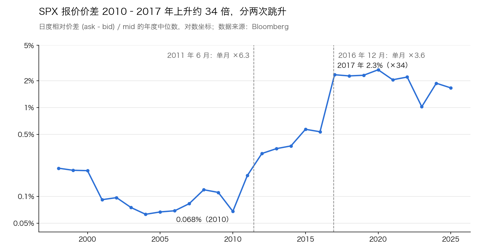

# SPX 买卖价差的 Regime 感知预测

*Shangrong Li, Siyu Liang, Wenyi Ye*

> 本文是英文报告 [report.md](report.md) 的中文翻译，内容与英文版逐节对应。

## 摘要

去除前视偏差后，标普 500 指数的日度相对买卖价差只能被中等程度地预测：最优模型是对 log 价差做的线性回归，样本外 R² 为 0.36，均方误差比持久性预测（明天 = 今天）低 28%。我们使用 Bloomberg 1998–2025 年共 6,972 个交易日的数据，采用完全样本外的设计：滚动拟合的隐马尔可夫模型（HMM）用前向滤波计算 regime 概率，线性、XGBoost、LightGBM 模型滚动训练，并用 Diebold–Mariano 检验比较预测精度。

主要有三个发现。第一，梯度提升模型没有胜过线性模型；加入 HAR 型长记忆特征（过去 5/22/63 日的平均 log 价差）是唯一显著提升精度的改动，普通交易日的平均绝对 log 误差从 0.210 降到 0.193（p < 0.001）。第二，HMM 能识别出持续性很强的 regime，高价差状态下的预测误差约为低价差状态的 8 倍；但在点预测、尖峰分类和区间预测中，只要有更简单的信号可用，HMM 概率就没有增量价值。第三，两个数据问题比任何建模选择都更重要：供应商用前一日数据填充的节假日行，以及指数报价在 2011 年 6 月和 2016 年 12 月的两次疑似口径跳变。断点处的检验指向口径变化，但每条主要结论在三个报价时期内都分别成立。如果使用平滑的样本内 regime 概率并按全样本过滤异常值，样本外 R² 会被虚增到约 0.89，本文说明了其成因。

## 1 引言

我们研究市场 regime 是否有助于预测 SPX 日度买卖价差，结论是：regime 能很好地描述风险，但不能提升预测。买卖价差是做市商承担订单处理、存货和逆向选择成本的补偿（Glosten & Milgrom, 1985; Kyle, 1985）。波动和信息不对称上升时价差会变宽，因此有理由认为区分 regime 的模型会比单一 regime 的模型预测得更好。

### 1.1 研究问题

1. 相对于持久性预测，日度相对价差在样本外的可预测程度有多高？
2. 非线性模型（XGBoost、LightGBM）能否优于线性模型？
3. 滚动 HMM 的 regime 概率对点预测、尖峰预测或预测区间是否有增量价值？
4. 哪些简单、有经济含义的特征（长记忆均值、日历效应）能提升精度？
5. 当价差序列的定义发生变化时，结论是否仍然成立？

### 1.2 贡献

- **无泄露的评估框架。** 所有特征和 regime 概率都只使用预测日之前可得的信息；我们证明，在训练窗口内做平滑的 HMM 会把样本外 R² 从约 0.36 虚增到 0.89。
- **关于 regime 特征的负面结果，并从多个角度检验：** 消融实验、三种重新设计的 HMM，以及区间预测和尖峰预测两个任务。
- **数据诊断：** 包括检验表明这条 Bloomberg 指数报价的两次水平跳变符合数据口径变化的特征，并核对每条主要结论在各报价时期内都成立。
- **正面结果：** log 空间建模和 HAR 长记忆特征有效；节假日和期权到期日效应在样本内显著。

## 2 数据

样本为 Bloomberg 标普 500 指数数据，去掉 1 条无效报价和 256 条供应商填充的节假日行后，共 6,972 个交易日（1998 年 3 月 2 日至 2025 年 11 月 13 日）。目标变量是相对价差 (PX_ASK − PX_BID) / PX_MID，预测变量来自 PX_LAST、PX_VOLUME、PX_CLOSE_1D 和 BEST_PE_RATIO。

### 2.1 供应商填充的节假日

Bloomberg 把交易所休市日（圣诞、元旦、感恩节等）用前一个交易日的数据原样填充：收盘价、成交量和报价完全相同。这 256 行不是真实观测，它们让价差在这些日子看起来完全持续，并让所有滞后变量错位一天，因此我们在构建特征前将其删除。

### 2.2 指数报价的水平跳变



价差中位数在 2011 年 6 月跳升 6.3 倍，2016 年 12 月跳升 3.6 倍，每次都在一个月内完成。SPX 的流动性不可能这样恶化，因此这些跳变很可能来自供应商计算指数 bid/ask 的方法变化——指数报价是合成报价，并非可交易的价格。这两次跳变影响了后面的所有结果：2016 年 12 月之后的误差约为之前的 25 倍，HMM 也有一部分在区分这些数据时代，而不是市场压力状态。因此我们在全文中都报告分时段结果，第 4.8 节对断点做了直接检验。

### 2.3 异常值

若某天的价差或 log 成交量落在**过去** 252 天的 1%–99% 分位数之外，就标记为异常值（共 527 天）。异常日只从训练窗口中剔除，测试集保留所有交易日，所以报告的精度也覆盖了尖峰日。

## 3 方法

对第 t 天的每一个预测，都只使用第 t−1 天收盘时可得的信息；所有模型、标准化器和 HMM 都只用过去的数据拟合。

### 3.1 特征

| 类别 | 特征 | 信息时点 |
| --- | --- | --- |
| 自回归 | t−1 和 t−2 日的 log 价差 | t−1 |
| 长记忆（HAR） | 过去 5、22、63 日的平均 log 价差 | t−1 |
| 波动率 | 5 日和 21 日已实现波动率（年化） | t−1 |
| 流动性 | log 成交量；Amihud 比率 \|r\|/成交量 | t−1 |
| 动量 | 价格与成交量的 5 日 / 20 日均线比 | t−1 |
| 估值 | 市盈率的日度变化 | t−1 |
| 事件 | 新冠哑变量，2020 年 3 月至 2022 年 12 月 | 已知 |
| 日历 | 节假日前后、月初月末、期权到期日、四重到期日、星期几 | 事先已知 |
| Regime | HMM 对高价差状态的滤波概率 | t−1 |

HAR 项借鉴波动率文献中的异质自回归模型，用于 log 价差 s：

```math
HAR^{(w)}_{t} = \frac{1}{w}\sum_{i=1}^{w} \log s_{t-i}, \qquad w \in \{5, 22, 63\}
```

### 3.2 样本外滚动 HMM

我们在 756 天的窗口上拟合两状态、全协方差的高斯 HMM，每 21 天重新拟合一次。输入为 log 价差、log 5 日波动率、log 成交量、log Amihud 比率和价格趋势，并在训练窗口内标准化。状态按拟合的价差均值排序，保证状态 1 始终是高价差状态。

每次拟合后的 21 天内，regime 概率用前向滤波计算，只用到 t 时刻及之前的观测：

```math
\alpha_t(k) = P(S_t = k \mid x_{1:t}) \propto \mathcal{N}(x_t;\, \mu_k, \Sigma_k) \sum_j \alpha_{t-1}(j)\, A_{jk}
```

注意不能对训练窗口内的日子调用 hmmlearn 的 `predict_proba`：它是前向–后向平滑器，会用到最多 20 天之后的数据，是第 5.1 节所述信息泄露的主要来源。

### 3.3 预测模型与验证

- **目标：** log 相对价差；预测值用 exp() 变换回水平值，所有精度指标都在水平值上计算。
- **模型：** 持久性预测（明天 = 今天）、标准化特征的 OLS、XGBoost 和 LightGBM（深度 3，学习率 0.05，子采样 0.8）。
- **滚动验证：** 每 21 天用前 500 天（剔除异常值）训练，其中最后 50 天用于早停，重新拟合后预测接下来的 21 天。
- **指标：** 水平值上的 RMSE、MAE、R² 和 skill = 1 − MSE / MSE（持久性）；用平均绝对 log 误差衡量普通交易日的精度。
- **检验：** Diebold–Mariano 检验，采用 Newey–West 方差（滞后 ⌊T^(1/3)⌋）和 Harvey–Leybourne–Newbold 小样本修正。

### 3.4 附加任务

**区间预测。** 90% 区间为 log ŷ ± 1.645σ_t，σ_t 由过去的样本外残差估计：250 天常数估计、EWMA（λ = 0.94），或按 HMM 概率加权的分状态方差。评分用 Gneiting–Raftery 区间得分，越低越好：

```math
IS_\alpha = (u - l) + \frac{2}{\alpha}(l - y)\,\mathbf{1}\{y < l\} + \frac{2}{\alpha}(y - u)\,\mathbf{1}\{y > u\}
```

**尖峰分类。** 若某天的 log 价差超过过去 252 天的 90% 分位数，则记为尖峰。Logistic 回归和 LightGBM 每 21 天用前 1,000 天重新拟合，用 AUC、平均精确率、Brier 分数以及风险最高的 10% 交易日中的精确率来比较。AUC 差异用 21 天分块 bootstrap 检验。

## 4 结果

### 4.1 点预测

对 log 价差的线性模型最准确，在 5,695 个预测日（2003–2025）上解释了 36% 的样本外方差。

| 模型 | RMSE | MAE | R² | 相对持久性的 skill | 过拟合差距（log 单位） |
| --- | --- | --- | --- | --- | --- |
| **线性，log 目标** | **0.01960** | **0.00329** | **0.361** | **0.282** | 0.018 |
| 线性，水平目标 | 0.01998 | 0.00362 | 0.336 | 0.254 | — |
| XGBoost | 0.02082 | 0.00363 | 0.279 | 0.190 | 0.082 |
| LightGBM | 0.02087 | 0.00357 | 0.275 | 0.186 | 0.060 |
| 持久性 | 0.02313 | 0.00370 | 0.110 | 0 | — |

梯度提升模型过拟合更严重（训练–验证差距是线性模型的 3–5 倍），预测也更差。但这些差异都不显著：XGBoost vs 线性 p = 0.12，LightGBM vs 线性 p = 0.11，线性 vs 持久性 p = 0.28，log vs 水平目标 p = 0.08。平方误差由少数尖峰日主导，导致检验功效很弱。

不同数据时代的精度差别很大。2016 年 12 月之前线性模型 R² = 0.69，之后只有 0.18，RMSE 约为之前的 25 倍。将 416 个异常日从测试集中剔除后，R² 升至 0.57，skill 升至 0.62。

特征重要性也说明了同样的问题。在最后一个滚动窗口中，XGBoost 的平均 |SHAP| 对 1 日滞后为 0.086、对 2 日滞后为 0.067，其余特征均低于 0.01，HMM 概率在 10 个特征中排第 8。

### 4.2 Regime

滚动 HMM 识别出两个持续的 regime，静态聚类则不行。对同样的特征做 K-means，最优轮廓系数只有 0.25（K = 5），其中一个簇由少数极端价差日构成，因此我们不再使用它。

| | 低价差状态 0 | 高价差状态 1 |
| --- | --- | --- |
| 天数 | 3,129 | 3,067 |
| 相对价差中位数 | 0.10% | 0.60% |
| 5 日波动率均值 | 13.1% | 17.6% |
| 留在本状态的概率（各次拟合平均） | 0.954 | 0.943 |
| 预期持续时间 | 约 22 天 | 约 18 天 |
| 线性模型预测 RMSE | 0.0034 | 0.0265 |

高价差状态同时伴随更高的波动和更低的成交量，预测误差约为低价差状态的 8 倍。它的占比也与数据时代高度相关：在样本前五分之一只占 2%，在第四个五分之一占 70%。因此，这个 regime 既是市场压力指标，也在一定程度上是数据时代指标。

### 4.3 Regime 能否提升点预测？

不能。去掉 HMM 概率后，所有模型的样本外 R² 变化都小于 0.005（线性 0.361 vs 0.357，p = 0.35；XGBoost p = 0.42；LightGBM p = 0.76）。针对 HMM 可能冗余的原因，我们又尝试了三种重新设计：

| 设定 | 线性 R² | p（vs 无 HMM） | LightGBM R² | p（vs 无 HMM） |
| --- | --- | --- | --- | --- |
| 无 HMM | 0.353 | — | 0.262 | — |
| 基准 HMM | 0.358 | 0.33 | 0.263 | 0.73 |
| 局部 z 分数 HMM：输入相对自身过去 63 天标准化，去除时代效应 | 0.355 | 0.33 | 0.264 | 0.42 |
| 动态 HMM：输入为 Δlog 价差、\|收益率\|、Δlog 成交量，避免与回归特征重叠 | 0.354 | 0.52 | 0.261 | 0.58 |
| 基准 HMM × 价差滞后，允许持续性随 regime 变化 | 0.346 | 0.34 | 0.260 | 0.72 |

没有一个变体与不含 regime 的模型有显著差异。

### 4.4 长记忆与日历特征

HAR 长记忆项是唯一显著提升精度的新增特征。提升体现在普通交易日上，用平均绝对 log 误差衡量（近似于平均百分比误差）：

| 模型 | 设定 | 平均绝对 log 误差 | DM p（log 误差） | R²（水平值） |
| --- | --- | --- | --- | --- |
| 持久性 | — | 0.221 | — | 0.110 |
| 线性 | 基准 | 0.210 | — | 0.361 |
| 线性 | + HAR | **0.193** | 0.0002 | 0.360 |
| 线性 | + 日历 | 0.209 | 0.65 | 0.361 |
| LightGBM | 基准 | 0.229 | — | 0.275 |
| LightGBM | + HAR | 0.221 | 0.016 | 0.292 |

加入 HAR 后，普通交易日的误差从比持久性低 5% 变为低 12%。线性模型的水平 R² 几乎不变，因为它由尖峰日决定。

日历效应在样本内存在，但幅度太小，对预测没有帮助。对 log 价差的日度变化做 OLS（HAC 标准误），节假日前一天价差约宽 6%（t = 2.4），每月第一个交易日约窄 8%（t = −3.3），月度期权到期日约窄 6%（t = −2.3）；星期效应不显著。

### 4.5 Regime 能否改善预测区间？

只有小幅改善，而简单的 EWMA 好得多。下表是线性预测 90% 区间的结果，区间得分越低越好。

| 波动估计方法 | 覆盖率 | 状态 1 覆盖率 | 区间得分 |
| --- | --- | --- | --- |
| 常数（250 天） | 90.1% | 88.1% | 1.366 |
| rv_5 高于中位数（非 HMM 标志） | 90.7% | 88.9% | 1.362 |
| 基准 HMM regime | 90.9% | 89.7% | 1.345 |
| 局部 z 分数 HMM regime | 91.0% | 89.3% | 1.361 |
| **过去残差的 EWMA** | 90.8% | 90.1% | **1.228** |
| EWMA × HMM regime 比例 | 91.1% | 90.8% | 1.247 |

基准 HMM 显著优于常数宽度区间（p = 0.005），这是本研究中 HMM 唯一显著的贡献。但它显著不如 EWMA（p < 0.001），两者组合也不如单用 EWMA（p < 0.001）：近期残差本身已经说明了市场是否动荡，而且反应更快。

### 4.6 尖峰预测

尖峰可以预测，但几乎完全来自"昨天的价差离阈值有多近"。在评估期内，15% 的交易日出现尖峰。

| 分类器 | AUC | 平均精确率 | 风险最高 10% 中的精确率 |
| --- | --- | --- | --- |
| 朴素：昨天是尖峰 | 0.724 | 0.354 | 0.518 |
| 朴素：昨天离阈值的距离 | 0.833 | 0.532 | 0.622 |
| Logistic，无 HMM | 0.826 | 0.548 | 0.607 |
| Logistic，+ HMM | 0.823 | 0.545 | 0.615 |
| **Logistic，+ HMM + HAR + 日历** | **0.841** | **0.564** | 0.619 |
| LightGBM，+ HMM + HAR + 日历 | 0.814 | 0.494 | 0.568 |

完整的 logistic 模型优于不含 HAR 和日历项的版本（AUC +0.018，95% 分块 bootstrap 置信区间 0.005 至 0.031），但不显著优于朴素距离规则（+0.008，置信区间 −0.011 至 0.027）。加入 HMM 使 AUC 变化 −0.003（置信区间 −0.007 至 0.001），LightGBM 显著不如 logistic 回归。

### 4.7 经济价值

我们测试了一个择时规则：只有当第 t 天的预测价差低于过去 60 天预测值的中位数时才交易。相对每个 21 天区块的平均价差，它把平均成本降低约 2%（线性 2.0%，XGBoost 2.3%）。持久性预测也能达到 2.3%，而完美预知是 13.8%。模型能预测价差水平，但对相邻交易日的排序能力很弱，因此择时价值有限。累计实际价差与累计预测价差的对比没有信息量，因为任何无偏预测的累计值都会跟随实际累计值。

### 4.8 跨报价时期的稳健性

**两次跳变更像是数据口径的变化。** 两次跳变都非常突然：水平变化的 90%（2011 年 6 月 1 日）和 100%（2016 年 12 月 5 日）发生在第一天，之后一直停在新水平。2016 年 12 月时其他变量都没有变化：在断点前后各 20 天内，log 价差的变化幅度排在所有日期的前 1.3%，而波动率、绝对收益率和成交量的变化都很普通（分别处于第 30、第 2 和第 59 百分位）。2011 年 6 月的情况没那么干净，因为当月波动率也上升了（第 90 百分位）。但同一时间报价结构也变了：2011 年 6 月之前，卖价几乎贴着收盘价（高出 0.003%，而买价低 0.033%）；之后报价变得对称（0.12% 和 0.11%）。流动性冲击会让报价两侧同时变宽，但不会改变报价的构造方式。因此我们把两次断点都视为口径变化，其中 2011 年那次的确定性较低。

**主要结论在每个时期都成立。** 我们在两个断点处把预测日分成三个时期：A（2003 年至 2011 年 5 月，2,059 天）、B（2011 年 6 月至 2016 年 11 月，1,366 天）和 C（2016 年 12 月至 2025 年，2,228 天），并去掉每个断点后的前 21 个交易日。然后在每个时期内分别检验每条结论；✓ 表示在 5% 水平下成立。

| 结论（除特别说明外用绝对 log 误差） | 时期 A | 时期 B | 时期 C |
| --- | --- | --- | --- |
| 线性模型优于 XGBoost 和 LightGBM | ✓ | ✓ | ✓ |
| HAR 项提升线性模型（平均绝对 log 误差变化） | ✓ −0.013 | ✓ −0.024 | ✓ −0.015 |
| 线性 + HAR 优于持久性（skill） | ✓ 0.14 | ✓ 0.19 | ✓ 0.08（p = 0.03） |
| HMM 概率没有显著增益 | ✓（p = 0.05） | ✓ | ✓ |
| EWMA 区间优于 HMM 区间（区间得分） | ✓ | 方向相同，p = 0.11 | ✓ |
| 尖峰模型不优于朴素规则（AUC） | ✗ +0.035 | ✓ | ✓ |

只有两格不成立。时期 B 中 EWMA 的优势方向正确但不显著。时期 A 中尖峰分类器确实优于朴素规则，AUC 高 0.035（95% 置信区间 0.017 至 0.071）。

**稳健推断。** 在平方误差下，统计推断非常弱：线性模型相对持久性的 skill 的 95% 分块 bootstrap 置信区间从 −0.40 到 0.48，因为结果由少数尖峰日决定。在绝对 log 误差下，同样的比较就很精确：

| 效应（绝对 log 误差） | 估计值 | 95% 置信区间 |
| --- | --- | --- |
| 线性 + HAR 相对持久性的 skill | 0.123 | 0.082 至 0.158 |
| HAR 项（平均绝对 log 误差变化） | −0.017 | −0.022 至 −0.012 |
| 线性 − XGBoost | −0.023 | −0.033 至 −0.015 |
| 含 HMM − 不含 HMM | +0.0003 | −0.0010 至 0.0017 |

90% 模型置信集（MCS；Hansen, Lunde & Nason, 2011）给出一致的结论。在绝对 log 误差下，全样本和时期 B 的置信集只有线性 + HAR 一个模型；时期 C 的置信集是 {持久性、线性、线性 + HAR}；时期 A 中所有模型都处于边界（p 值均为 0.107）。在平方误差下，除时期 B 外 MCS 无法区分各模型。

## 5 讨论

### 5.1 信息泄露如何把 R² 虚增到 0.89

以下三种常见做法会把未来信息带进特征，并删掉最难预测的测试日；三者叠加时样本外 R² 约为 0.89：

1. **平滑的、样本内的 regime 概率。** HMM 用前向–后向概率给每个训练窗口的最后 21 天打标签，所以每天的"滞后"regime 都用到了最多 20 天之后的数据。
2. **先按全样本删除异常值，再计算滞后。** 价差和成交量落在全样本 1%–99% 分位数之外的日子（约 290 天）在构建滞后变量之前就被删除了。这样做用到了未来信息，删掉了最难预测的测试日，还让许多"lag-1"变成了更早的观测。
3. **双向插值和节假日副本。** 时间插值用未来值填补缺口，256 个节假日行让价差看起来完全持续。

对 regime 模型的启示是：hmmlearn 的 `predict_proba` 是平滑器。做预测时，只有用更早数据拟合的模型得到的滤波概率才是有效的。

### 5.2 HMM 为什么帮不上预测

HMM 把回归已经使用的变量（价差、波动、成交量）压缩成一个 0 到 1 之间的数。次日价差主要由它自身的近期水平决定，而回归可以直接、更细致地看到这些信息。分 regime 的动态（第 4.3 节）和替代输入都没有改变这一点。在只有约 6,000 个观测、并有两次水平跳变的单条日度序列上，regime 很大程度上在区分数据时代。

Regime 在描述层面仍然有用。它能标出预测精度低约 8 倍的时期，并相对常数宽度区间带来小幅但显著的改善。实务中可将它作为风险标志，例如加宽执行成本的缓冲。但若要预测价差本身，近期残差波动和长记忆均值是更好的工具。

### 5.3 梯度提升为什么不如线性模型

可预测的部分主要来自 log 价差平滑、近乎线性的持续性：两个滞后项就占了绝大部分 SHAP 重要性。每个训练窗口只有约 450 个非异常日，序列在不同时代之间还有水平跳变。在这种情况下，树模型会把能力花在拟合噪声上，其训练–验证差距是线性模型的 3–5 倍也说明了这一点。

### 5.4 指数价差衡量的是什么

标普 500 指数本身不能交易，所以它的 bid 和 ask 不是任何人能成交的价格，而是供应商计算出的合成报价。我们不知道具体的构造方法，但突然的水平跳变说明它至少改变过两次。由此有两点推论。第一，这个价差的水平不是交易成本，它在 2010 到 2017 年间上升 34 倍，并不说明 SPX 的流动性变差。第二，能从中学到的是这条序列的可预测性：它的持续性、长记忆以及对波动率的反应。这些性质在三种口径下都成立，说明它们来自市场行为，而不是某一种构造方法。它们能否推广到可交易的价差（例如 SPY 或 E-mini 期货报价），需要在那些标的上检验。

### 5.5 局限性

- **研究对象。** SPX 的 bid/ask 是供应商合成的报价，并非可交易报价（见第 5.4 节）。
- **断点。** 断点检验只是间接证据，只有供应商的文档才能确认口径变化。我们在各时期内分别评估，但没有对断点本身建模。
- **事件哑变量。** 新冠哑变量的结束日期（2022 年 12 月）是事后才知道的，存在轻微的前视偏差。
- **输入变量。** 没有包含 VIX、订单簿深度和日内数据，而它们都是已知的价差驱动因素。
- **检验功效弱。** 平方误差的 DM 检验由尖峰日主导；若干具有实际意义的点预测差异在统计上不显著。

## 6 结论与未来工作

SPX 日度价差具有中等的可预测性（样本外 R² 0.36，MSE 比持久性低 28%），而且简单模型效果最好。推荐的设定是带 HAR 长记忆项、以 log 价差为目标的线性回归。梯度提升带来的是过拟合而不是精度。去除前视偏差后，隐马尔可夫 regime 是有用的描述和风险标志工具，但没有预测价值。这些结论在三个报价时期内都分别成立，因此不依赖于序列的某一种定义。对结论影响最大的是数据处理：供应商填充的节假日、指数报价的水平跳变，以及平滑 regime 概率和全样本过滤造成的信息泄露。

未来工作（按预期价值排序）：

1. **加入 VIX** 及其他市场压力指标，它们是文献中记录最充分、而本文缺失的价差驱动因素。
2. **换成可交易标的**（SPY 或 E-mini 期货报价），其价差是真实的交易成本，也没有合成报价的口径断点。
3. **使用个股横截面。** 更大的样本可以检验 regime 和非线性模型在数据充足时是否有用。
4. **联合估计马尔可夫切换 AR 模型**，取代本文的两步法。
5. **直接预测价差风险**，例如对 log 价差做分位数回归或 GARCH 类模型，在 EWMA 结果的基础上延伸。

## 参考文献

1. Diebold, F. X., & Mariano, R. S. (1995). Comparing predictive accuracy. *Journal of Business & Economic Statistics*, 13(3), 253–263.
2. Glosten, L. R., & Milgrom, P. R. (1985). Bid, ask and transaction prices in a specialist market with heterogeneously informed traders. *Journal of Financial Economics*, 14(1), 71–100.
3. Kyle, A. S. (1985). Continuous auctions and insider trading. *Econometrica*, 53(6), 1315–1335.
4. Lundberg, S. M., & Lee, S.-I. (2017). A unified approach to interpreting model predictions. *Advances in Neural Information Processing Systems*, 30.
5. Newey, W. K., & West, K. D. (1987). A simple, positive semi-definite, heteroskedasticity and autocorrelation consistent covariance matrix. *Econometrica*, 55(3), 703–708.
6. Corsi, F. (2009). A simple approximate long-memory model of realized volatility. *Journal of Financial Econometrics*, 7(2), 174–196.
7. Harvey, D., Leybourne, S., & Newbold, P. (1997). Testing the equality of prediction mean squared errors. *International Journal of Forecasting*, 13(2), 281–291.
8. Gneiting, T., & Raftery, A. E. (2007). Strictly proper scoring rules, prediction, and estimation. *Journal of the American Statistical Association*, 102(477), 359–378.
9. Amihud, Y. (2002). Illiquidity and stock returns: cross-section and time-series effects. *Journal of Financial Markets*, 5(1), 31–56.
10. Hamilton, J. D. (1989). A new approach to the economic analysis of nonstationary time series and the business cycle. *Econometrica*, 57(2), 357–384.
11. Hansen, P. R., Lunde, A., & Nason, J. M. (2011). The model confidence set. *Econometrica*, 79(2), 453–497.

## 复现

所有结果均来自 [`notebooks/`](../notebooks/) 中的四个 notebook，按顺序运行，随机种子固定；它们之间通过本地 SQLite 数据库传递数据。Regime 时间线在 notebook 1，SHAP 图在 notebook 2，滚动 RMSE、残差诊断、ROC 和校准曲线在 notebook 3，断点检验、分时期结果和 MCS 在 notebook 4。
